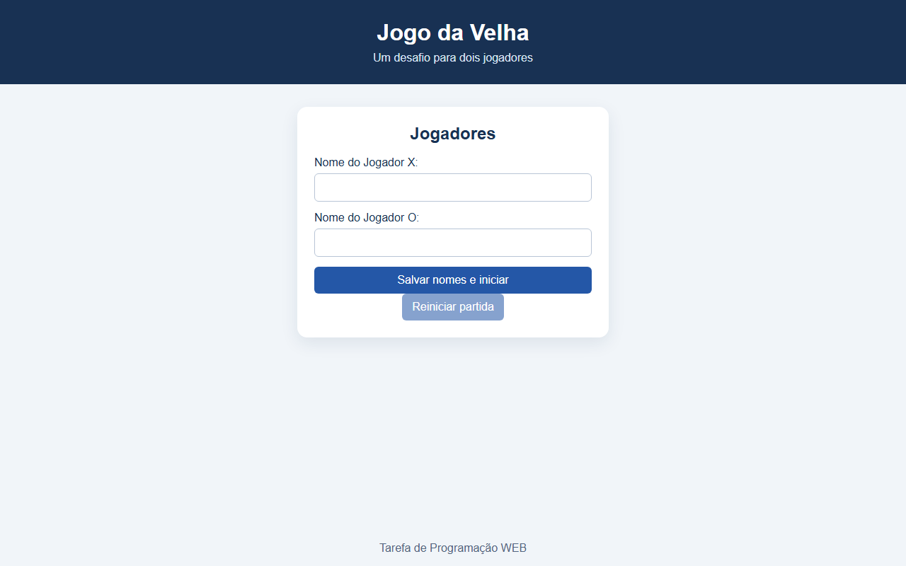

# Jogo da Velha

Jogo da velha para dois jogadores no navegador, feito em HTML, CSS e JavaScript puro (sem bibliotecas). Atividade avaliativa da disciplina **SI401 — Programação para a Web** (FT-Unicamp, 2º semestre de 2026).

**[▶ Jogar agora](https://rafasuet.github.io/jogo-da-velha-SI401/)**

## Funcionalidades

- Cadastro do nome dos jogadores X e O antes da partida.
- Indicação de quem joga na vez, detecção de vitória (8 combinações) e de empate.
- Tabuleiro bloqueado ao fim da partida e botão para reiniciar sem recarregar a página.
- Acessível: as casas são `<button>`s com `aria-label`, e os avisos usam `aria-live` para leitores de tela.

## Como rodar

Não precisa instalar nada: abra o `index.html` no navegador.

## Estrutura

| Arquivo | Conteúdo |
| --- | --- |
| `index.html` | Formulário dos jogadores, tabuleiro e mensagens |
| `style.css` | Layout e estilos |
| `script.js` | Estado do tabuleiro, turnos e verificação de vitória/empate |
